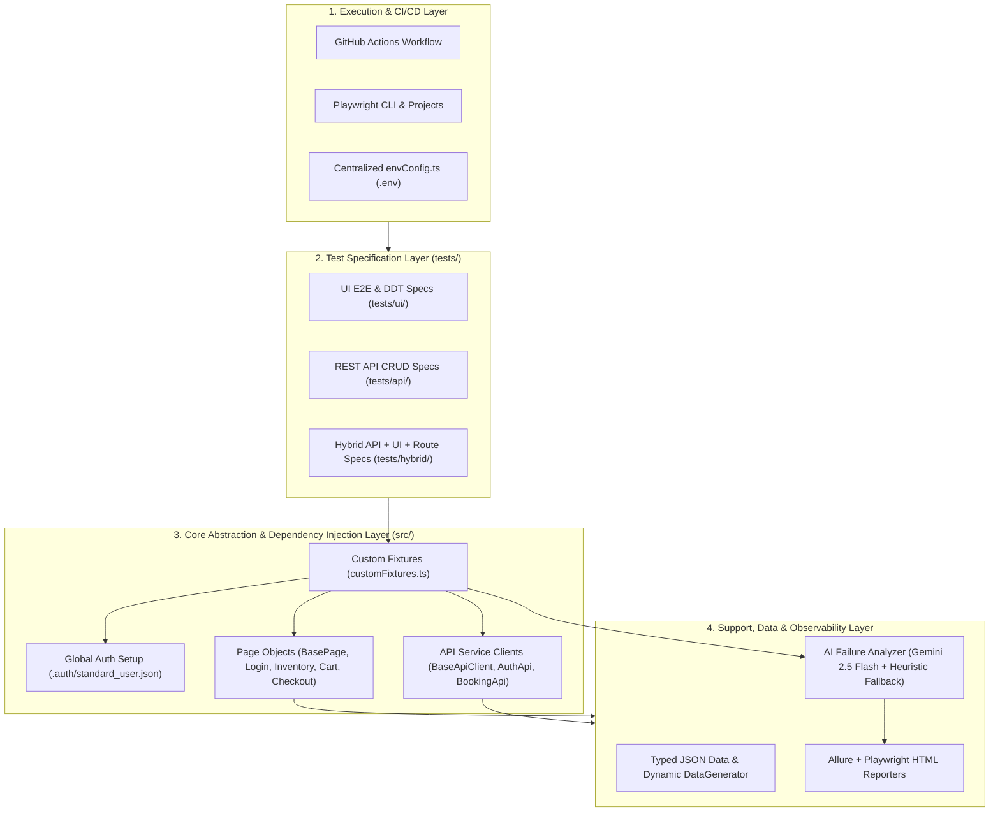

# 🚀 IntelliTest – AI-Powered End-to-End Test Automation Framework


**IntelliTest** is a scalable, maintainable **Hybrid End-to-End (UI + REST API + Network Interception)** Test Automation Framework engineered with **Playwright** and **TypeScript**. It demonstrates practical SDET architecture patterns including **Custom Fixture Dependency Injection**, **Global Authentication `storageState` Reuse**, **Service Object API Clients**, **Data-Driven Testing (DDT)**, and a **Fault-Tolerant AI Failure Diagnostic Engine** powered by Google Gemini.

---

## 🏗️ Framework Architecture



---

## ✨ Key SDET Engineering Features

1. **Zero-Boilerplate Dependency Injection (`customFixtures.ts`):**
   - Extends Playwright's `test` object to inject instantiated Page Objects (`loginPage`, `inventoryPage`, `cartPage`, `checkoutPage`) and API Service Clients (`authApi`, `bookingApi`) directly into test arguments.
2. **Global Authentication State Reuse (`auth.setup.ts`):**
   - Authenticates once prior to UI suite execution and persists session cookies/localStorage to `.auth/standard_user.json`, reducing UI test execution time by ~60%.
   - Supports scoped session resets (`test.use({ storageState: { cookies: [], origins: [] } })`) for testing unauthenticated and negative login flows.
3. **Object-Oriented Page Object Model (`src/pages/`):**
   - `BasePage` encapsulates navigation, action wrappers, structured timestamps (`Logger`), and automatic Allure `test.step()` reporting.
   - Dynamic chained locators (`.filter({ hasText }).getByRole(...)`) avoid brittle CSS/XPath selectors.
4. **Service Object REST API Layer & `Zod` Runtime Schema Validation (`src/api/`):**
   - `BaseApiClient` wraps Playwright's native `APIRequestContext` with explicit base URL resolution so API calls work seamlessly inside both pure API tests and UI Hybrid tests.
   - Uses **`Zod` (`booking.schema.ts`)** as a single source of truth for both compile-time TypeScript types (`z.infer<>`) and runtime JSON schema contract validation (`BookingPayloadSchema.parse()`).
   - Full CRUD (`POST`, `GET`, `PUT`, `PATCH`, `DELETE`), token cookie authentication, and negative authorization (`403 Forbidden`) coverage.
5. **Automated WCAG 2.1 Web Accessibility (a11y) Auditing (`tests/ui/accessibility.spec.ts`):**
   - Integrates **`@axe-core/playwright`** to scan Login, Inventory, and Shopping Cart screens against `wcag2a`, `wcag2aa`, `wcag21a`, and `wcag21aa` compliance rules, attaching full JSON accessibility audit reports to Allure and Playwright HTML reports.
6. **Hybrid Testing & Network Interception (`tests/hybrid/`):**
   - Seeds and verifies backend records via REST API before consuming them in UI E2E checkout workflows.
   - Uses Playwright `page.route()` network interception to mock custom backend responses and verify UI resilience.
7. **Dual-Engine AI Failure Diagnostics (`aiFailureAnalyzer.ts`):**
   - Triggered automatically **only on test failure** via an `{ auto: true }` fixture teardown hook—zero latency or cost on passing tests.
   - Calls **Google Gemini (`gemini-3.1-flash-lite`)** when `ENABLE_AI_ANALYSIS=true` and `GEMINI_API_KEY` is configured, and automatically falls back to a **Deterministic Heuristic Root-Cause Classifier** when offline or unconfigured.
   - Attaches `AI_Failure_Analysis.md` directly to Allure and Playwright HTML reports.
8. **Docker Containerization & GitHub Pages Live Report Deployment:**
   - Includes `Dockerfile` (`mcr.microsoft.com/playwright`) and `docker-compose.yml` for zero-setup containerized execution.
   - GitHub Actions CI/CD automatically deploys the interactive Playwright HTML Dashboard to **GitHub Pages** on every push to `main`.

---

## 📂 Project Directory Structure

```text
intellitest/
├── .github/
│   └── workflows/
│       └── playwright-ci.yml      # GitHub Actions CI/CD pipeline (Push, PR & Manual Dispatch)
├── src/
│   ├── api/
│   │   ├── endpoints/
│   │   │   ├── AuthApi.ts         # POST /auth token service client
│   │   │   └── BookingApi.ts      # CRUD /booking service client
│   │   ├── schemas/
│   │   │   └── booking.schema.ts  # TypeScript interfaces for API payloads & responses
│   │   └── BaseApiClient.ts       # Core HTTP wrapper with Allure step logging
│   ├── data/
│   │   ├── products.json          # Externalized product catalog & customer test data
│   │   └── users.json             # Valid, locked-out, and invalid user personas for DDT
│   ├── fixtures/
│   │   └── customFixtures.ts      # Dependency Injection for POMs, API Clients & AI Hook
│   ├── pages/
│   │   ├── BasePage.ts            # Abstract base page with shared actions & step wrapper
│   │   ├── LoginPage.ts           # Login screen locators & validations
│   │   ├── InventoryPage.ts       # Product catalog sorting, filtering & cart actions
│   │   ├── CartPage.ts            # Shopping cart verification & item removal
│   │   └── CheckoutPage.ts        # Multi-step checkout form, subtotal math & confirmation
│   ├── types/
│   │   └── testData.types.ts      # Strict TypeScript interfaces for JSON data
│   └── utils/
│       ├── aiFailureAnalyzer.ts   # Gemini LLM + Heuristic Fallback failure analyzer
│       ├── dataGenerator.ts       # Parallel-safe dynamic test data generator
│       ├── envConfig.ts           # Centralized dotenv configuration manager
│       └── logger.ts              # Structured ISO-timestamp step & console logger
├── tests/
│   ├── setup/
│   │   └── auth.setup.ts          # Global auth setup saving .auth/standard_user.json
│   ├── ui/
│   │   ├── login.spec.ts          # Auth, logout, direct URL guard & 4 DDT negative cases
│   │   ├── inventory.spec.ts      # Catalog sorting (A-Z, Z-A, Price) & cart badge tests
│   │   └── checkout.spec.ts       # Multi-item E2E checkout & price subtotal validation
│   ├── api/
│   │   └── booking.api.spec.ts    # Token auth, full CRUD lifecycle & 403 negative auth
│   └── hybrid/
│       └── hybridFlow.spec.ts     # API state seeding -> UI E2E + page.route mocking
├── .env.example                   # Environment variable template
├── playwright.config.ts           # Multi-project Playwright configuration
├── package.json                   # Dependencies and execution scripts
└── tsconfig.json                  # Strict TypeScript & path alias configuration
```

---

## 🧪 Automated Test Suite Inventory (21 Automated Scenarios)

| Test ID | Suite | Scenario Description | Key Engineering Concept Demonstrated |
| :--- | :--- | :--- | :--- |
| `auth.setup` | Setup | Authenticate `standard_user` once and save session state | Global `storageState` persistence (`.auth/standard_user.json`) |
| `TC-UI-001` | UI Auth | Valid standard user login and sidebar logout | Scoped `storageState` reset + POM interaction |
| `TC-UI-DDT` (x4) | UI Auth | Data-Driven negative login tests (`USR_002` to `USR_005`) | Parameterized DDT loop over `src/data/users.json` |
| `TC-UI-002` | UI Auth | Unauthenticated user blocked from `/inventory.html` | Route protection & security error banner assertion |
| `TC-UI-003` | UI Catalog | Product catalog sorting by Name (`A-Z` & `Z-A`) | Dynamic UI text extraction & algorithmic array comparison |
| `TC-UI-004` | UI Catalog | Product catalog sorting by Price (`Low-High` & `High-Low`) | Currency string parsing & numeric sort verification |
| `TC-UI-005` | UI Catalog | Adding and removing items updates cart badge dynamically | Chained `.filter({ hasText })` locators & state assertions |
| `TC-UI-006` | UI E2E | Multi-item E2E checkout with dynamic subtotal calculation | Dynamic data generation + `.reduce()` price math check |
| `TC-UI-007` | UI E2E | Remove item inside Cart before completing order | Cart state mutation & updated subtotal verification |
| `TC-UI-008` | UI E2E | Checkout Step One form validation for missing Postal Code | Negative form validation on authenticated flow |
| `TC-A11Y-001` | UI a11y | WCAG 2.1 Level A/AA Accessibility Audit on Login Screen | Automated `@axe-core/playwright` audit & JSON attachment |
| `TC-A11Y-002` | UI a11y | WCAG 2.1 Level A/AA Accessibility Audit on Inventory & Cart | Multi-page accessibility compliance scanning |
| `TC-API-001` | REST API | Admin token generation (`POST /auth`) & bad credential check | `Zod` runtime contract validation (`AuthTokenResponseSchema`) |
| `TC-API-002` | REST API | Full Booking CRUD (`POST` -> `GET` -> `PUT` -> `PATCH` -> `DELETE` -> `404`) | Stateful API lifecycle + `Zod` `BookingPayloadSchema.parse()` |
| `TC-API-003` | REST API | Unauthorized `PUT` and `DELETE` rejected with `403 Forbidden` | API security & negative authorization testing |
| `TC-API-004` | REST API | Query parameter filtering on `GET /booking?firstname=...` | Dynamic data seeding & `BookingIdListSchema` validation |
| `TC-HYB-001` | Hybrid | Seed customer via REST API (`POST /booking`) -> UI Checkout | Cross-layer API data creation + UI E2E consumption |
| `TC-HYB-002` | Hybrid | Intercept & mock `/api/v1/inventory-health` via `page.route` | Network interception, fulfillment & UI stock assertion |

---

## ⚡ Quick Start & Execution Guide

### 1. Clone & Install Dependencies
```bash
git clone <your-repo-url>
cd intellitest
npm install
npx playwright install --with-deps chromium
```

### 2. Configure Environment Variables
Copy `.env.example` to `.env` (defaults work out-of-the-box):
```bash
cp .env.example .env
```
*(Optional)* To enable live Google Gemini AI failure diagnostics on failed tests, set in `.env`:
```env
ENABLE_AI_ANALYSIS=true
GEMINI_API_KEY=your_actual_gemini_api_key
```

### 3. Run Test Suites
```bash
# Run UI, REST API, and Hybrid suites in parallel
npx playwright test --project=chromium-ui --project=api-tests --project=hybrid-tests

# Run only UI E2E tests (Chromium)
npm run test:ui

# Run only REST API CRUD & Auth tests
npm run test:api

# Run only Hybrid (API + UI + Network Mocking) tests
npm run test:hybrid

# Run WCAG 2.1 Web Accessibility (a11y) Audit Suite
npm run test:a11y

# Run inside Docker Container (Zero local browser setup required)
docker compose up --build

# Run Cross-Browser UI Suite (Chromium, Firefox, WebKit)
npm run test:cross-browser

# Run Smoke Tests only (@smoke tag)
npx playwright test --grep @smoke

# Run TypeScript Compiler Type Check
npm run typecheck
```

### 4. View Test Reports
```bash
# Open Playwright Interactive HTML Report (includes traces, screenshots & AI_Failure_Analysis.md)
npm run report:pw

# Generate and open Allure HTML Dashboard (requires Java installed for Allure CLI)
npm run report:allure:generate
npm run report:allure:open
```
